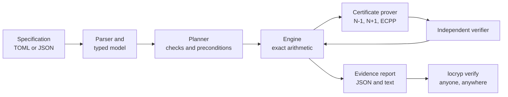
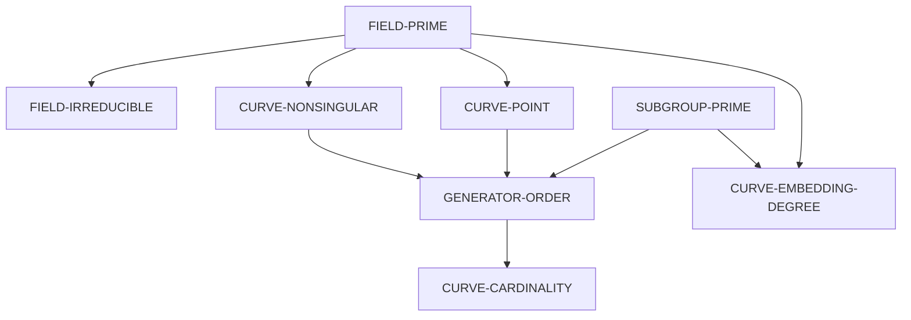

# locryp

**Proof-carrying verification for the algebra behind cryptographic parameters.**

Every cryptosystem built on finite fields and elliptic curves rests on a handful of number-theoretic claims: this modulus is prime, this polynomial is irreducible, this point generates a subgroup of prime order r, this curve has exactly N points, this subgroup does not embed into a small extension field. These claims are usually copied from a standard, checked by a one-off script, or simply trusted.

locryp turns those claims into theorems. It reads a declarative specification, decides each claim by exact computation, and writes an evidence report in which every positive answer is either a direct exact computation or carries a **machine-checkable certificate** that anyone can re-verify without trusting locryp, its search heuristics, or its author.

```
$ locryp check examples/secp256k1.toml

PASS   FIELD-PRIME             Fp         the modulus p of Fp is prime
       method: primality certificate (pocklington), checked by the independent verifier
PASS   SUBGROUP-PRIME          secp256k1  the subgroup order r is prime
       method: primality certificate (morrison), checked by the independent verifier
PASS   GENERATOR-ORDER         secp256k1  G has order exactly r
       method: scalar multiplication with the prime factors of r
PASS   CURVE-CARDINALITY       secp256k1  secp256k1 has exactly 115792089237316195423570985008687907852837564279074904382605163141518161494337 points over Fp
       method: Hasse interval contains exactly one multiple of the order of G
PASS   CURVE-EMBEDDING-DEGREE  secp256k1  the embedding degree of the order r subgroup is at least 100
       method: exhaustive search below the bound
8 PASS
```

The whole tool is pure Python standard library, with no dependencies.

---

## Contents

1. [Mathematical origin](#mathematical-origin)
2. [How it works](#how-it-works)
3. [What it proves](#what-it-proves)
4. [Why every answer is sound](#why-every-answer-is-sound)
5. [Certificates](#certificates)
6. [Finding certificates: N - 1, N + 1, and complex multiplication](#finding-certificates)
7. [Statuses, dependencies, and conditional results](#statuses-dependencies-and-conditional-results)
8. [Specification format](#specification-format)
9. [Examples](#examples)
10. [Command line](#command-line)
11. [Performance](#performance)
12. [Architecture](#architecture)
13. [Limits](#limits)
14. [References](#references)

---

## Mathematical origin

This project grew out of a close reading of

> Levent Alpoge, Nicholas M. Katz, Gabriel Navarro, E. A. O'Brien, and Pham Huu Tiep,
> **Local Systems and Suzuki Groups**, Contemporary Mathematics 800, American Mathematical Society, 2024.
> A copy is included in this repository: [`local systems and suzuki groups.pdf`](local%20systems%20and%20suzuki%20groups.pdf).

For $q = 2^{2n+1}$, $q_0 = 2^n$, and $t(q) = q + 1 - 2q_0$, the paper studies a rank $D = q_0(q-1)$ local system $\mathcal F_q$ on $\mathbb A^1/\mathbb F_2$. It is built as the Fourier transform of the Artin-Schreier-Witt sheaf attached to the length two Witt vector

$$
\left[\,x^{t(q)},\ \sum_{i=1}^{n} x^{(1+2^i)\,t(q)}\right] \in W_2(\mathbb F_2[x]),
$$

whose Frobenius traces are explicit exponential sums over $W_2(k) \to \mathbb Z/4\mathbb Z$ with character $[a,b] \mapsto i^{a^2+2b}$. Katz conjectured that its geometric monodromy group is the Suzuki group ${}^2B_2(q)$ in one of its two lowest dimensional representations. The paper proves:

* For every $q$, the geometric monodromy group is either ${}^2B_2(q)$ or $\mathrm{SL}_D$. The proof goes through the condition (S+), geometric primitivity, and primitive prime divisors of $t(q)$ (Theorem 3.4).
* For $q = 8$, it is exactly ${}^2B_2(8)$ in degree 14, and the arithmetic monodromy group over $\mathbb F_2$ is $\mathrm{Aut}({}^2B_2(8))$. Ruling out $\mathrm{SL}_{14}$ took a fourth moment computation over $\mathbb F_{2^{18}}^\times$ of about 7500 CPU hours in Magma. The computation bounds $M_{2,2}$ through the estimate

$$
\left|\frac{1}{q-1}\sum_{u\in\mathbb F_q^\times}\operatorname{Tr}\left(\mathrm{Frob}_u \mid \mathcal H_0^{a,b}\right)\right|
\le \frac{q}{q-1}M_{a,b} + \frac{A\sqrt q}{q-1} + \frac{B-A}{q-1}.
$$

* For $q \ge 32$ the question remains open.

The lesson locryp takes from the paper is methodological, not a transfer of its geometry. The paper never trusts a global structural claim. It pins the claim down with exact local invariants (traces, inertia characters, element orders, prime divisors of torus orders) and with theorems that turn those invariants into proofs. locryp applies the same discipline to cryptographic parameters. Global claims (primality, cardinality, subgroup order, field structure) are reduced to small, exactly checkable local facts, and each step is justified by a named theorem. The Suzuki group itself appears in [`examples/suzuki_sz8.toml`](examples/suzuki_sz8.toml), where locryp confirms that two explicit $4 \times 4$ matrices over $\mathbb F_8$ generate a group of order exactly $|{}^2B_2(8)| = q^2(q^2+1)(q-1) = 29120$.

locryp does not use the paper's cohomological methods, and it makes no claim about the Suzuki monodromy conjecture.

---

## How it works



The prover and the verifier are deliberately separate. The prover is a search procedure full of heuristics: Pollard rho, class polynomial root finding, random curve twists. None of that can affect correctness, because nothing the prover produces is reported until the verifier, a short sequence of exact integer checks, has accepted it. The same verifier runs again when a third party executes `locryp verify report.json`.

---

## What it proves

| Check | Statement | Decided by |
|---|---|---|
| `FIELD-PRIME` | the field modulus $p$ is prime | primality certificate, or a compositeness witness |
| `FIELD-IRREDUCIBLE` | an extension modulus is irreducible, so the quotient ring is a field | Rabin's test over the declared base, including towers such as $\mathbb F_{p^{12}}$ |
| `CURVE-NONSINGULAR` | $4a^3 + 27b^2 \ne 0$ | exact field arithmetic |
| `CURVE-POINT` | $G$ satisfies $y^2 = x^3 + ax + b$ | exact field arithmetic |
| `SUBGROUP-PRIME` | the subgroup order $r$ is prime | primality certificate |
| `CURVE-NOT-ANOMALOUS` | $r \ne \operatorname{char} \mathbb F$, excluding the Smart-Satoh-Araki-Semaev attack | integer comparison |
| `GENERATOR-ORDER` | $G$ has order exactly $r$ | $[r]G = \mathcal O$ and $[r/\ell]G \ne \mathcal O$ for every proven prime $\ell \mid r$ |
| `CURVE-COFACTOR` | $N = hr$, or $r \mid N$ | integer arithmetic |
| `CURVE-CARDINALITY` | $\#E(\mathbb F_q) = N$ | Hasse interval uniqueness, or an exhaustive count for $q \le 2^{20}$ |
| `CURVE-EMBEDDING-DEGREE` | the embedding degree is exactly $k$, or at least $B$ (default 100, following SEC 1) | modular exponentiation |
| `GROUP-MATRICES` | matrix generators are invertible | Gaussian elimination |
| `GROUP-RELATOR` | a word in the generators equals the identity | exact matrix arithmetic |
| `GROUP-ELEMENT-ORDER` | a word has order exactly $k$ | exact matrix arithmetic with the prime factors of $k$ |
| `GROUP-ORDER` | the generated group has exactly $n$ elements | exhaustive enumeration, up to two million elements |
| `R1CS-WITNESS` | a witness satisfies every rank one constraint $\langle a,w\rangle\langle b,w\rangle = \langle c,w\rangle$ | exact field arithmetic |

---

## Why every answer is sound

**Compositeness.** A number is declared composite only with a nontrivial factor or a base $a$ for which the strong Miller-Rabin test fails. Either one can be checked by hand.

**Primality.** A number is declared prime only through one of four certificate forms, each a theorem.

*Small primes.* For $n < \psi_{13} = 3317044064679887385961981$, the strong pseudoprime test to the first thirteen prime bases is deterministic (Sorenson and Webster).

*Pocklington, with the Brillhart-Lehmer-Selfridge extension.* Let $F \mid n-1$, with every prime $q \mid F$ proven. Suppose that for each such $q$ there is an $a_q$ with $a_q^{\,n-1} \equiv 1$ and $\gcd(a_q^{(n-1)/q} - 1, n) = 1$. Then every prime factor of $n$ is congruent to $1 \bmod F$. Hence $n$ is prime if $(F+1)^2 > n$. If only $F^3 \ge n$ holds, write $n = c_2F^2 + c_1F + 1$. Then $n$ is prime when $c_1^2 - 4c_2$ is not a perfect square, because a composite $n$ would factor as $(aF+1)(bF+1)$ with $c_1 = a+b$ and $c_2 = ab$.

*Morrison.* Let $F \mid n+1$ with $(F-1)^2 > n$. Suppose that for each proven prime $q \mid F$ there is a Lucas sequence $(P,Q)$ with $\gcd(n, 2QD) = 1$, $n \mid U_{n+1}$, and $\gcd(U_{(n+1)/q}, n) = 1$. Then the rank of apparition at every prime $\ell \mid n$ is divisible by $F$ and divides $\ell \pm 1$. So $\ell \ge F - 1 > \sqrt n$, and $n$ is prime.

*Goldwasser-Kilian.* Let $\gcd(n,6) = 1$, let $E$ be nonsingular modulo $n$, and let $P \in E(\mathbb Z/n)$ satisfy $[m]P = \mathcal O$ with $[m/q]P$ affine, where $q$ is a proven prime and $q > (n^{1/4}+1)^2$. For a prime $\ell \le \sqrt n$ dividing $n$, the point $P \bmod \ell$ would have order divisible by $q$. But $q > (\ell^{1/2}+1)^2 \ge \#E(\mathbb F_\ell)$, which is impossible, so $n$ is prime. Two details keep this exact:

* Curve arithmetic modulo $n$ raises an error whenever a denominator is not a unit, so every computed step reduces to a valid step modulo each prime divisor of $n$.
* The real inequality is replaced by the integer test $(\lfloor\sqrt q\rfloor - 1)^4 > n$, which implies it.

**Cardinality.** If $G$ has order exactly $r$, then $r \mid \#E(\mathbb F_q)$. Hasse's theorem places $\#E$ in the interval

$$
\left[\,q+1-\lfloor\sqrt{4q}\rfloor,\ q+1+\lfloor\sqrt{4q}\rfloor\,\right],
$$

and this interval is computed without rounding. If it contains exactly one multiple of $r$, that multiple is the cardinality. This is how the cofactor 8 of Curve25519 is proven rather than assumed. A claim outside the interval is refuted outright.

**Irreducibility.** A monic $f$ of degree $d$ over $\mathbb F_Q$ is irreducible if and only if $f \mid x^{Q^d} - x$ and $\gcd(f, x^{Q^{d/r}} - x) = 1$ for every prime $r \mid d$ (Rabin). The test is run over the declared base field, so towers are proven one level at a time. Each level is conditional on the level below.

**Exact orders.** If $g^n = 1$ and $g^{n/\ell} \ne 1$ for every prime $\ell \mid n$, then $g$ has order exactly $n$. locryp applies this only when every $\ell$ is itself proven prime. Otherwise the result is `NOT_PROVEN`.

---

## Certificates

Certificates are plain JSON trees of decimal strings. Here is a complete certificate for $n = 2^{128} + 51$, produced by `locryp prove`:

```json
{
  "n": "340282366920938463463374607431768211507",
  "method": "pocklington",
  "factors": [
    { "q": "2",       "e": "1", "base": "2", "certificate": { "n": "2",       "method": "deterministic-miller-rabin" } },
    { "q": "3",       "e": "5", "base": "2", "certificate": { "n": "3",       "method": "deterministic-miller-rabin" } },
    { "q": "17",      "e": "1", "base": "2", "certificate": { "n": "17",      "method": "deterministic-miller-rabin" } },
    { "q": "89",      "e": "1", "base": "2", "certificate": { "n": "89",      "method": "deterministic-miller-rabin" } },
    { "q": "6481",    "e": "1", "base": "2", "certificate": { "n": "6481",    "method": "deterministic-miller-rabin" } },
    { "q": "5816689", "e": "1", "base": "2", "certificate": { "n": "5816689", "method": "deterministic-miller-rabin" } }
  ]
}
```

Larger certificates nest all four methods. The proof that Curve25519's subgroup order $\ell = 2^{252} + 27742317777372353535851937790883648493$ is prime descends through four elliptic curve steps before $n \pm 1$ becomes tractable. The verifier is about 100 lines of straight-line integer arithmetic in [`certificates.py`](src/locryp/certificates.py), and it is the only code a skeptical reader needs to audit.

---

## Finding certificates

<a id="finding-certificates"></a>

For each probable prime $n$, the prover tries three strategies in order and recurses on every new prime it needs.

1. **$n - 1$.** Factor $n - 1$ by trial division and Brent's variant of Pollard rho. Collect proven prime powers until Pocklington or Brillhart-Lehmer-Selfridge applies.
2. **$n + 1$.** The same, with Lucas sequence witnesses for Morrison's theorem.
3. **Elliptic curve primality proving (Atkin-Morain).** For each of 457 imaginary quadratic discriminants $D$ with class number at most 12:
   * solve $4n = u^2 + |D|v^2$ by Cornacchia's algorithm;
   * read off the candidate curve orders $m = n + 1 \pm u$ (and the extra twists for $D = -3, -4$);
   * strip small factors to expose a probable prime $q > (n^{1/4}+1)^2$;
   * build a curve with CM by $D$ from a root of the Hilbert class polynomial $H_D$ modulo $n$.

   Recursion on $q$ continues until $n \pm 1$ or the deterministic range finishes the job.

The Hilbert class polynomials are computed inside locryp from the reduced binary quadratic forms of discriminant $D$:

$$
H_D(x) = \prod_{(a,b,c)} \left(x - j\!\left(\tfrac{-b+\sqrt D}{2a}\right)\right),
\qquad
j(\tau) = \frac{E_4(\tau)^3}{q\prod_{n\ge1}(1-q^n)^{24}},
\quad q = e^{2\pi i\tau}.
$$

The computation uses arbitrary precision fixed-point complex arithmetic (Machin's formula for $\pi$, Taylor series with argument reduction), then rounds every coefficient to an integer and rejects the result unless each rounding is within $2^{-16}$. The test suite checks them against known values, including $j\big(\tfrac{1+\sqrt{-163}}{2}\big) = -640320^3$. As with every heuristic in the prover, a wrong class polynomial could only make the search fail. It could never produce an accepted certificate.

---

## Statuses, dependencies, and conditional results

| Status | Meaning |
|---|---|
| `PASS` | established by the recorded method |
| `FAIL` | false for the supplied input, with a counterexample or the failing equality in the evidence |
| `NOT_PROVEN` | probably true, but not established within the search budget |
| `ASSUMED` | declared as an assumption in the specification and not checked |
| `INDETERMINATE` | could not be decided, for example because a precondition failed |
| `NOT_APPLICABLE` | the check does not apply to the declared object |

Checks form a dependency graph:



If a precondition fails, its dependents are not run and are reported as `INDETERMINATE`. They are never silently passed. If a precondition is unsettled (`NOT_PROVEN`, `ASSUMED`, or `INDETERMINATE`), its dependents still run, and each lists that precondition under `conditional_on`, transitively. A conditional `PASS` is therefore never displayed as unconditional. locryp produces no aggregate score, and a passing report makes no claim about protocol or implementation security.

---

## Specification format

Specifications are TOML or JSON. Integers may be native integers, decimal strings, or `0x` hexadecimal strings. Extension field elements are coefficient lists over the base, constant term first, and they nest for towers.

```toml
locryp = 1
name = "BN254"

[fields.Fp]
prime = "21888242871839275222246405745257275088696311157297823662689037894645226208583"

[fields.Fp2]
base = "Fp"
modulus = [1, 0, 1]

[fields.Fp6]
base = "Fp2"
modulus = [[-9, -1], 0, 0, 1]

[curves.G1]
field = "Fp"
a = "0"
b = "3"
subgroup_order = "21888242871839275222246405745257275088548364400416034343698204186575808495617"
cofactor = "1"
embedding_degree = 12

[curves.G1.generator]
x = "1"
y = "2"
```

In this example, `modulus = [1, 0, 1]` declares $\mathbb F_{p^2} = \mathbb F_p[u]/(u^2+1)$, and `[[-9, -1], 0, 0, 1]` declares $\mathbb F_{p^6} = \mathbb F_{p^2}[v]/(v^3 - (9+u))$.

Matrix groups take generators, relator words such as `"(s*T)^13"`, exact element orders, and a group order. Constraint systems take sparse rank one constraints and an optional witness. Any planned check can be skipped with `assumptions = ["CURVE-CARDINALITY:E"]`. Unknown keys, malformed integers, and unsupported models are rejected with the exact path of the problem; nothing is guessed.

---

## Examples

| File | Contents | Result |
|---|---|---|
| [`secp256k1.toml`](examples/secp256k1.toml) | Bitcoin's curve | 8 PASS |
| [`p256.toml`](examples/p256.toml) | NIST P-256 | 8 PASS |
| [`wei25519.toml`](examples/wei25519.toml) | Curve25519 in short Weierstrass form, cofactor 8 | 9 PASS, including an elliptic curve primality proof of $\ell$ |
| [`bn254.toml`](examples/bn254.toml) | $\mathbb F_p \subset \mathbb F_{p^2} \subset \mathbb F_{p^6} \subset \mathbb F_{p^{12}}$, $G_1$, and the $G_2$ twist over $\mathbb F_{p^2}$ | 18 PASS, embedding degrees 12 and 6 |
| [`suzuki_sz8.toml`](examples/suzuki_sz8.toml) | ${}^2B_2(8)$ as $4\times4$ matrices over $\mathbb F_8$ | 11 PASS, order 29120 |
| [`flawed.toml`](examples/flawed.toml) | seven planted defects | 7 FAIL, 1 INDETERMINATE |

`flawed.toml` is worth running. Every planted defect is caught with its counterexample:

* The strong pseudoprime 3825123056546413051, which passes Miller-Rabin to the first nine prime bases.
* The reducible extension modulus $u^2 + 2$, with the common factor reported.
* A supersingular curve whose embedding degree is 2.
* A wrong cardinality, refuted with the true value $4r$.
* An off-curve generator. Its order check is blocked rather than passed.
* A wrong R1CS witness, with the failing constraint identified.

---

## Command line

```
pip install -e .

locryp check  SPEC [--report FILE] [--effort low|normal|high] [--strict] [--quiet]
locryp verify REPORT
locryp prove  INTEGER [--output FILE] [--effort low|normal|high]
```

| Command | Exit 0 | Exit 1 | Exit 2 | Exit 3 |
|---|---|---|---|---|
| `check` | nothing failed | some check failed | invalid specification | with `--strict`, some result unsettled |
| `verify` | every certificate valid | some certificate invalid | unreadable report | |
| `prove` | certified prime | proven composite | invalid integer | not proven |

Reports record the tool version, the SHA-256 of the specification, the effort level, and for every check its statement, method, status, preconditions, and evidence. They contain no timestamps, so the same input gives the same report.

---

## Performance

All figures were measured on a laptop with CPython 3.14, single threaded.

| Task | Time |
|---|---|
| full check of P-256 | 0.2 s |
| full check of BN254, including the $\mathbb F_{p^{12}}$ tower | 0.7 s |
| full check of secp256k1 | 1.5 s |
| full check of Curve25519 | 1.9 s |
| enumerating ${}^2B_2(8)$ | 7 s |
| certifying a random 256-bit prime | 0.6 s average |
| certifying a random 384-bit prime | 3.2 s average |
| certifying a random 521-bit prime | 10 s average, 7 of 8 within the default budget |

---

## Architecture

| Module | Responsibility |
|---|---|
| [`numtheory.py`](src/locryp/numtheory.py) | sieve, Jacobi symbol, Baillie-PSW, Tonelli-Shanks, Lucas sequences, Brent-Pollard factorization |
| [`algebra.py`](src/locryp/algebra.py) | $\mathbb Z/n$, extension field towers, polynomial arithmetic, Rabin's test |
| [`ec.py`](src/locryp/ec.py) | short Weierstrass arithmetic over any declared ring, faithful modulo composite $n$ |
| [`cm.py`](src/locryp/cm.py) | reduced forms, Hilbert class polynomials, roots modulo $n$ |
| [`certificates.py`](src/locryp/certificates.py) | the certificate prover and the independent verifier |
| [`matrices.py`](src/locryp/matrices.py) | matrix arithmetic, word parsing, group enumeration |
| [`spec.py`](src/locryp/spec.py) | strict specification parsing into a typed model |
| [`engine.py`](src/locryp/engine.py) | check planning, dependency propagation, check implementations |
| [`report.py`](src/locryp/report.py), [`cli.py`](src/locryp/cli.py) | reports and the command line |

```
PYTHONPATH=src python3 -m unittest discover -s tests
```

The suite has 50 tests. Among them:

* primality agrees with trial division below $10^5$;
* Rabin's test reproduces Gauss's count $\frac1d\sum_{k\mid d}\mu(d/k)\,q^k$ of irreducible polynomials;
* the group law is associative on an exhaustively enumerated curve;
* computed class polynomials match known values;
* every numeric change to a proven quantity in a real certificate is rejected;
* composites are never certified.

---

## Limits

* The curve model is short Weierstrass in characteristic greater than 3. Montgomery and Edwards curves are checked through their Weierstrass forms.
* Cardinality over extension fields, such as the $G_2$ twist of BN254, is decided only when the Hasse interval contains a single multiple of $r$. Otherwise the result is `INDETERMINATE`.
* Matrix group order is decided by enumeration, so it is limited to groups with at most two million elements.
* Pure Python favors auditability over speed. Primes above roughly 600 bits may need `--effort high`.
* locryp checks a mathematical specification. It does not check that an implementation matches that specification, and it does not check constant-time behavior, side channels, or protocol security.

---

## References

1. L. Alpoge, N. M. Katz, G. Navarro, E. A. O'Brien, P. H. Tiep. *Local Systems and Suzuki Groups.* Contemp. Math. 800, AMS, 2024. [PDF in this repository](local%20systems%20and%20suzuki%20groups.pdf).
2. N. M. Katz. *Exponential Sums, Ree Groups and Suzuki Groups: Conjectures.* Experimental Mathematics 28, 2019.
3. M. Suzuki. *On a class of doubly transitive groups.* Annals of Mathematics 75, 1962.
4. H. C. Pocklington. *The determination of the prime or composite nature of large numbers by Fermat's theorem.* Proc. Cambridge Phil. Soc. 18, 1914.
5. J. Brillhart, D. H. Lehmer, J. L. Selfridge. *New primality criteria and factorizations of 2^m +/- 1.* Mathematics of Computation 29, 1975.
6. M. A. Morrison. *A note on primality testing using Lucas sequences.* Mathematics of Computation 29, 1975.
7. S. Goldwasser, J. Kilian. *Primality testing using elliptic curves.* Journal of the ACM 46, 1999.
8. A. O. L. Atkin, F. Morain. *Elliptic curves and primality proving.* Mathematics of Computation 61, 1993.
9. J. Sorenson, J. Webster. *Strong pseudoprimes to twelve prime bases.* Mathematics of Computation 86, 2017.
10. M. O. Rabin. *Probabilistic algorithms in finite fields.* SIAM Journal on Computing 9, 1980.
11. R. Crandall, C. Pomerance. *Prime Numbers: A Computational Perspective.* Springer, second edition, 2005.
12. H. Cohen. *A Course in Computational Algebraic Number Theory.* Springer, 1993.
13. Standards for Efficient Cryptography Group. *SEC 1: Elliptic Curve Cryptography*, version 2.0, 2009.
14. N. P. Smart. *The discrete logarithm problem on elliptic curves of trace one.* Journal of Cryptology 12, 1999.
